# Trading natural gas systematically

### Trend, market structure and fundamentals — a Zipline / pyfolio backtest study

*Veljko Perovic— commodity analyst. Built 2026.*

------------------------------------------------------------------------

**TL;DR.** I take a single instrument — NYMEX natural gas (NG) — and look at it from three angles: **price trend**, **curve structure (carry)**, and **fundamentals** (weather and storage). Every idea is turned into a systematic, vol-targeted rule and backtested over 2000–2026 with one cost model, one rolling convention and one risk framework, so the results are directly comparable. Individually the edges are modest and fat-tailed. Combined into a **handcrafted book**, they give a Sharpe of 0.38, a −29 % max drawdown and a p-value of 2.5 % — the whole point of the exercise.

> **Note on data.** Raw futures prices are scraped from Barchart and are *not* redistributed here for licensing reasons. EIA storage and NOAA weather data are public. The repo ships the **results** (`results/Results.xlsx`, the equity and monthly-return series produced by the backtests) and the code, so every chart and table below can be regenerated without the price data.

## Contents

- [Why natural gas?](#why-natural-gas)
- [Data & method](#data-method)
- [How to read the numbers](#how-to-read-the-numbers)
- [The strategies](#the-strategies)
  1.  [Beta](#beta-the-benchmark)
  2.  [EWMAC 16/64](#ewmac-1664) 3–7. [EWMAC — different speeds](#ewmac-different-speeds) 8–11. [Carry — trading the curve](#carry-trading-the-curve)
  3.  [Trading realised weather](#trading-realised-weather) 13–14. [Inventory — trading the gas balance](#inventory-trading-the-gas-balance)
- [The handcrafted NG book](#the-handcrafted-ng-book)
- [Things to consider](#things-to-consider)
- [Repository layout](#repository-layout)
- [Reproducing the results](#reproducing-the-results)

## Why natural gas?

In this project I want to (1) show my methodology and way of thinking, and (2) show that I am more than a niche (dairy) analyst.

I deliberately avoided agricultural commodities — that is what I encounter every day at work. I opted for an energy instrument instead and chose natural gas, which I had heard is easy to make money on. A former Amaranth Advisors trader assured me so. *(/s)*

In general I believe in an **idea-first approach** - where market properties (trend and structure) are combined with fundamentals. I am both an agnostic and a believer: I do believe that understanding and trading around fundamentals can give better risk-adjusted returns, but I also know that, through overconfidence and bias, we tend to explain more price action than can actually be explained.

## Data & method

| Ingredient | Source | Notes |
|----|----|----|
| Futures prices | Barchart scraper | per-contract OHLC, reindexed onto zipline’s `us_futures` calendar |
| Storage | EIA Weekly Natural Gas Storage Report | Lower-48 stocks, Bcf, 1993→ |
| Weather | NOAA | population-weighted gas-weighted degree days (GWDD) |
| Backtester | Zipline-Reloaded + pyfolio | continuous futures via `continuous_future(root, offset=k, roll='calendar', adjustment='mul')` |
| Cost model | in-house | roll-aware fixed slippage + per-contract commission |

**Universe.** A single root: **NG** (NYMEX natural gas), traded as a continuous, back-adjusted series.

**Roll convention.** We always trade the **rolling third contract**: the position is held in the third contract of the curve and, as each contract approaches expiry, it is rolled forward into the new third contract. Roll legs are charged a discounted spread (see *Costs* below).

**Position sizing.** Every strategy targets **1 % of account equity as daily P&L volatility** per position:

    contracts = (equity × 1%) / (σ_daily × price_multiplier) × conviction

where `conviction` is the signal’s strength, capped at ±2. Daily σ blends a fast EWMA (span 32) with a slow 1,260-day estimate (0.7 / 0.3). Positions are only adjusted when the target changes by **more than 15 %**, which stops the strategy overtrading (and paying the costs that come with it).

**Costs.** Every fill is charged the full spread, and commission is charged per contract. For NG the backtest uses:

| Cost          | Setting           | In practice                           |
|---------------|-------------------|---------------------------------------|
| Slippage      | 0.001 \$/mmBtu    | fill at price ± \$0.001               |
| Roll slippage | 0.0005 \$/mmBtu   | fill at price ± \$0.0005 on roll legs |
| Commission    | \$1.25 / contract | \$2.50 round-trip (entry + exit)      |

Commission and slippage can each be switched off to see the gross signal.

## How to read the numbers

- **Annual return (net)** = the compounded yearly return, after commission and slippage.
- **Annual volatility** = the standard deviation of daily returns, annualised.
- **Sharpe** = average daily return ÷ daily volatility, annualised (× √252).
- **Sortino** = annual return ÷ annualised downside volatility (only the losing days count).
- **Max drawdown** = the worst peak-to-trough loss over the sample.
- **Average drawdown** = the average of all the underwater periods — how deep you typically sit below a previous high.
- **Skew (monthly)** = skewness of monthly returns. Positive means a long right tail (many small losses, the occasional big gain); negative is the opposite.
- **Lower / upper tail ratio** = fat-tail test: (1st/30th percentile) ÷ 4.43 and (99th/70th percentile) ÷ 4.43 on de-meaned returns, where 4.43 is the ratio in a normal distribution.
- **Stability** = R² of a straight-line fit to log-equity — how steadily the equity curve trends up.
- **t-statistic / p-value** = a one-tailed test of whether the daily Sharpe is really above zero. Ideally we want **p \< 2.5 %** to validate the strategy.
- **Beta** = how much of the strategy is just the 16/64 benchmark (1 = identical).
- **Alpha** = the annualised return the benchmark cannot explain — the part that is genuinely this strategy’s own.
- **Gross Sharpe** is the Sharpe before commission and slippage; **Costs (Sharpe units)** is what those costs subtract; **annual turnover** is how many times the book is turned over per year.

Each strategy below is followed by its equity / drawdown / rolling-Sharpe chart and its full metric table, then a short **“My read”** note.

------------------------------------------------------------------------

# The strategies

## 1. Beta — the benchmark

The beta strategy will not be part of the portfolio; I use it to measure the other strategies against. The idea is as old as trading: we throw the efficient market theory in the garbage bin and buy when EWMA-16 crosses above EWMA-64. We sell when it crosses below. Each time that happens we allocate 1 % of the portfolio to natural-gas futures.

**Why should it work?** We are betting that returns have a memory. One explanation is prospect theory; my own is that the *economic variables that drive prices also have a memory*. A cow that gives us a lot of milk today is likely to give us a lot of milk tomorrow aswell, low stocks today tend to mean low stocks tomorrow, and so on. The more a price has the ability to influence those drivers back quickly, the less trendy the market can be.


| Metric | Value |
|---|---|
| Annual return (net) | 4.63% |
| Annual volatility | 19.21% |
| Sharpe ratio | 0.33 |
| Sortino ratio | 0.38 |
| Max drawdown | -43.30% |
| Average drawdown | -20.77% |
| Skew (monthly) | 1.06 |
| Lower tail ratio (1/30 ÷ 4.43) | 2.977 |
| Upper tail ratio (99/70 ÷ 4.43) | 2.895 |
| Stability (R² of log-equity) | 0.79 |
| t-statistic | 1.727 |
| p-value (one-tailed) | 4.21% |
| Beta to 16/64 benchmark | 1.000 |
| Alpha vs benchmark (ann.) | 0.00% |

**My read.** Beta looks surpisingly decent looking at Sharpe only. Tails are very fat and skew is not too impressive considering we are trend-following.

## 2. EWMAC 16/64

I borrow this strategy from Rob Carver. It works like the beta rule, except we also scale our conviction. A bare cross of 16 over 64 does not mean much if the market is going sideways, so to measure how much momentum the market is really showing on a multi-week horizon, we measure **how many σ units EWMA-16 leads EWMA-64** (or trails it). 2.5σ is the average for most commodity markets and gets an average-sized position; 1.25σ gets 50 % less size; 5σ brings us to the max. I cap positions at ±2 to avoid being oversized and to avoid fat left tails — which is especially painful when the volatility regime changes.

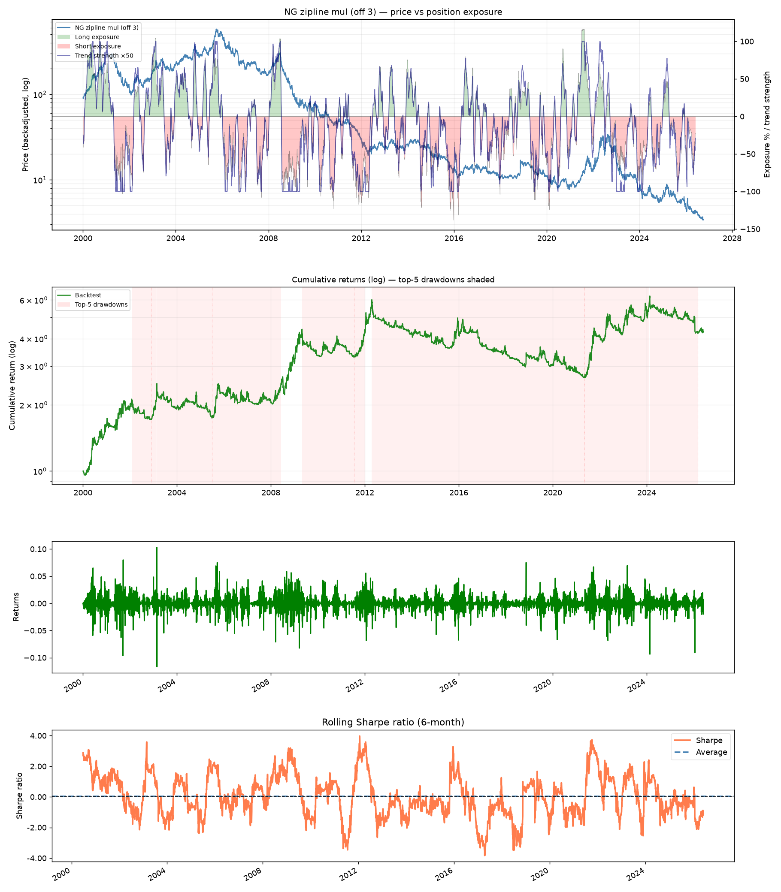

| Metric | Value |
|---|---|
| Annual return (net) | 5.40% |
| Annual volatility | 19.16% |
| Sharpe ratio | 0.37 |
| Sortino ratio | 0.44 |
| Max drawdown | -56.49% |
| Average drawdown | -23.97% |
| Skew (monthly) | 1.23 |
| Lower tail ratio (1/30 ÷ 4.43) | 2.811 |
| Upper tail ratio (99/70 ÷ 4.43) | 2.915 |
| Stability (R² of log-equity) | 0.65 |
| t-statistic | 1.926 |
| p-value (one-tailed) | 2.71% |
| Gross Sharpe (before costs) | 0.39 |
| Costs (Sharpe units) | 0.02 |
| Annual turnover | 16.4x / yr |
| Beta to 16/64 benchmark | 0.935 |
| Alpha vs benchmark (ann.) | 1.08% |

**My read.** Sharpe is marginally higher and we get 1.22% alpha verus it’s less sophisticated cousin. Skew looks a bit better. Passes the t-test which signals robustness.

## 3–7. EWMAC — different speeds

16/64 is a mid-paced pair. I can also construct **2/8**, **4/16, 32/128 and 64/256 (and a hundred different pairs).** They are meant to capture different speeds of trend as we don’t know exactly which pace the market will have in an individual year. Short ones are basically trends within trends while the long ones present long term trends and cycles.


| Metric | 2/8 | 4/16 | 8/32 | 16/64 | 32/128 | 64/256 |
|---|---|---|---|---|---|---|
| Annual return (net) | -0.58% | 1.04% | 3.72% | 5.40% | 5.03% | 4.38% |
| Annual volatility | 19.53% | 19.28% | 19.00% | 19.16% | 19.21% | 20.25% |
| Sharpe ratio | 0.07 | 0.15 | 0.29 | 0.37 | 0.35 | 0.31 |
| Sortino ratio | -0.05 | 0.09 | 0.31 | 0.44 | 0.41 | 0.34 |
| Max drawdown | -58.37% | -56.46% | -58.92% | -56.49% | -47.30% | -50.23% |
| Average drawdown | -31.65% | -26.94% | -26.48% | -23.97% | -21.51% | -25.20% |
| Skew (monthly) | 1.10 | 1.47 | 1.47 | 1.23 | 0.64 | 0.68 |
| Lower tail ratio (1/30 ÷ 4.43) | 2.553 | 2.752 | 2.815 | 2.811 | 2.821 | 2.300 |
| Upper tail ratio (99/70 ÷ 4.43) | 2.726 | 2.813 | 3.043 | 2.915 | 2.619 | 2.116 |
| Stability (R² of log-equity) | 0.27 | 0.00 | 0.31 | 0.65 | 0.78 | 0.72 |
| t-statistic | 0.353 | 0.781 | 1.494 | 1.926 | 1.828 | 1.630 |
| p-value (one-tailed) | 36.22% | 21.75% | 6.76% | 2.71% | 3.38% | 5.16% |
| Gross Sharpe (before costs) | 0.16 | 0.21 | 0.32 | 0.39 | 0.37 | 0.33 |
| Costs (Sharpe units) | 0.094 | 0.056 | 0.035 | 0.024 | 0.018 | 0.017 |
| Annual turnover | 109.0x / yr | 55.9x / yr | 29.5x / yr | 16.4x / yr | 10.1x / yr | 7.1x / yr |
| Beta to 16/64 benchmark | 0.405 | 0.602 | 0.803 | 0.935 | 0.876 | 0.701 |
| Alpha vs benchmark (ann.) | -1.57% | -1.20% | 0.18% | 1.08% | 1.19% | 1.82% |

**My read** 2/8 and 4/16 are quite fast. They have a positive skew as they try to cut losses quickly. The very big turnover is not really offset by high returns as they come with lower expected returns and an underwhelming Sharpe. We have to be careful with those 2. 8/32 and 16/64 look to be the best pairs with nice skew and upper tails bigger than lower tails. 32/128 and 64/256 are almost as slow ass investsing and lose all the positive skew from the faster rules. There is a nice annual return and a decent Sharpe though. Costs are very low as our turnover is low.

## 8–11. Carry — trading the curve

8: Carry — convenience yield, premium. It has many names across industries and many interpretations: the price difference that keeps the supply chain running (paying people to store the product we don’t need), a weather premium, future expectations of the market, seasonality. All of these explanations are true, but we can’t know which one is true at any given moment — and we don’t need to. I borrow another rule from Rob Carver: put **annualised carry** (here between the 3rd and 2nd rolling NG contract) in relation to annualised vol to get an **implied Sharpe** of a trade in which the spot stays the same and the deferred slowly comes to us. An implied annual Sharpe of 0.35 gives an average position; 0.7 doubles it; and, as always, we cap there.

9: Commodity markets have periods of higher volatility in which it can be risky to wait for the carry to come to you (harvest in ags, winter in NG, the milk flush in dairy). That is why I also run a summer-only version, active for just the six off-season demand months (May–October).

10+11: Trading carry is nice, but as mentioned, one function of market structure is to adjust futures prices for (often strong) seasonal changes in supply and demand — new-crop MATIF wheat is frequently inverted versus old crop for exactly that reason. Talking wheat, let’s imagine an annualized Matif wheat spread of -120 while annualized vol stands at 240: that is an interesting annual Sharpe of 0.5. But what if the median spread for that time of year is actually −180? Suddenly −120 looks tight. Is spot demand strong? Are stocks tightening? Are we going to invert? I don’t want to overthink all those possibilities, so I use a seasonally adjusted rule that measures the current calendar spread against the **median structure over the previous 10 years during this month of the year**.

All in, I run four carry variants: raw and seasonally adjusted, each traded all year and summer-only. The summer-only versions score better, but I keep the all-year ones for robustness and diversification.


| Metric | Raw all-year | Raw summer | Adj all-year | Adj summer |
|---|---|---|---|---|
| Annual return (net) | -0.04% | 2.07% | 1.18% | 1.92% |
| Annual volatility | 25.32% | 18.24% | 21.31% | 14.59% |
| Sharpe ratio | 0.12 | 0.20 | 0.16 | 0.20 |
| Sortino ratio | -0.00 | 0.17 | 0.09 | 0.19 |
| Max drawdown | -78.95% | -59.47% | -73.82% | -61.05% |
| Average drawdown | -34.82% | -23.71% | -27.08% | -18.05% |
| Skew (monthly) | 0.77 | 0.31 | 0.29 | -0.11 |
| Lower tail ratio (1/30 ÷ 4.43) | 2.163 | 2.047 | 3.857 | 4.058 |
| Upper tail ratio (99/70 ÷ 4.43) | 1.742 | 1.618 | 3.341 | 2.711 |
| Stability (R² of log-equity) | 0.01 | 0.23 | 0.26 | 0.35 |
| t-statistic | 0.649 | 1.059 | 0.841 | 1.058 |
| p-value (one-tailed) | 25.81% | 14.48% | 20.01% | 14.51% |
| Gross Sharpe (before costs) | 0.16 | 0.22 | 0.19 | 0.22 |
| Costs (Sharpe units) | 0.035 | 0.020 | 0.028 | 0.020 |
| Annual turnover | 14.7x / yr | 16.0x / yr | 12.2x / yr | 12.6x / yr |
| Beta to 16/64 benchmark | 0.419 | 0.048 | 0.371 | 0.022 |
| Alpha vs benchmark (ann.) | 1.08% | 3.54% | 1.10% | 2.77% |

**My read.** Biggest concern when trading the carry should be the fat left tails. Our skew does not look so bad, except in the adj. summer rule. However lower tails are massive on the adjusted rule, especially thanks to the 2022 disaster that this strategy endures. Beta is low as carry is a decent diversifier from trend.

## 12. Trading realised weather

The idea: during winter, very cold weather raises gas demand and prices; mild weather does the reverse. For a material move in supply/demand, the extreme weather has to persist. Weather itself also has a memory of a couple of days, so a cold week can linger. Rule: if, over the last 7 days, we have averaged 2 °C below normal, open an average long; 4 °C below doubles it; 1 °C below opens a small position — and the reverse for shorts. We are only trading this strategy in the heating season (November-April).

I’ve validated the rule by playing with slightly longer and shorter number of days and degrees. The change in config does not materially change the backtest outcome.

Natural-gas markets in winter are probably influenced by *forecasts* before a cold snap even happens. I don’t have that data, and I’m not sure trading at such a frequency would fit the portfolio I’m building, so this trades the realised anomaly.


| Metric | Value |
|---|---|
| Annual return (net) | 4.33% |
| Annual volatility | 11.84% |
| Sharpe ratio | 0.42 |
| Sortino ratio | 0.57 |
| Max drawdown | -38.16% |
| Average drawdown | -7.57% |
| Skew (monthly) | 0.93 |
| Lower tail ratio (1/30 ÷ 4.43) | 2.281 |
| Upper tail ratio (99/70 ÷ 4.43) | 2.986 |
| Stability (R² of log-equity) | 0.95 |
| t-statistic | 2.168 |
| p-value (one-tailed) | 1.51% |
| Gross Sharpe (before costs) | 0.47 |
| Costs (Sharpe units) | 0.05 |
| Annual turnover | 74.2x / yr |
| Beta to 16/64 benchmark | 0.144 |
| Alpha vs benchmark (ann.) | 4.17% |

**My read.** Cummulative returns look beautiful, as stability is at a whooping 95%. Seems to perform in different market conditions. Skew at 0.93 and some very fat tails. Passes the t-test with ease. She is a keeper.

## 13–14. Inventory — trading the gas balance

13: Low inventories make for firm markets; ample inventories make for bear markets. If inventories are low today, there is a good chance they will still be low next week and perhaps the week after. Every Thursday we get the signal from the EIA weekly storage report, and we only trade in the winter season (November–April). If stocks are 10 % below last year we build an average-sized long; 20 % below gives the max position; 5 % below gives half conviction. The reverse holds for higher stocks.

14: Same storage idea, but instead of waiting for Thursday’s number I use a **nowcast** of it built from the latest weather-driven demand and flows, so the position can be put on *before* the release; on Monday.

I trade both versions: the after-release rule on Thursday’s number itself, and the nowcast, which can position ahead of it.


| Metric | After release (EIA) | Before release (nowcast) |
|---|---|---|
| Annual return (net) | 6.48% | 6.63% |
| Annual volatility | 16.59% | 16.08% |
| Sharpe ratio | 0.46 | 0.48 |
| Sortino ratio | 0.60 | 0.64 |
| Max drawdown | -43.53% | -43.90% |
| Average drawdown | -16.07% | -15.61% |
| Skew (monthly) | 1.76 | 2.50 |
| Lower tail ratio (1/30 ÷ 4.43) | 2.550 | 2.583 |
| Upper tail ratio (99/70 ÷ 4.43) | 2.244 | 2.331 |
| Stability (R² of log-equity) | 0.86 | 0.92 |
| t-statistic | 2.398 | 2.385 |
| p-value (one-tailed) | 0.83% | 0.86% |
| Gross Sharpe (before costs) | 0.47 | 0.49 |
| Costs (Sharpe units) | 0.013 | 0.014 |
| Annual turnover | 13.8x / yr | 13.6x / yr |
| Beta to 16/64 benchmark | 0.391 | 0.413 |
| Alpha vs benchmark (ann.) | 5.20% | 6.10% |

**My read.** The nowcast version does not overperform the after report version by much but does score marginally better in Sharpe, Vol, avg drawdown and a bit worse in lower tail ratio. Skew at a very nice 2.50.

**Three things stand out:**

- The **fundamental rules are the strongest**, and are weakly correlated to trend — that is where most of the diversification comes from.
- **Carry is the weakest** idea for NG. It only works when restricted to the off-season months, and the all-year version has a massive−78 % drawdown.
- Every strategy has a **fat left tail** (lower tail ratio \> 1.5)

------------------------------------------------------------------------

## The handcrafted NG book

The 13 traded strategies (the beta benchmark is excluded) are combined into a NG portfolio made of different trading rules. Such trading rule set is suitable for combining into a wider energy/commodity portfolio.

- **50 % trend** — the six EWMAC speeds
- **30 % fundamentals** — weather GWDD and EIA storage
- **20 % curve** — the four carry variants

**Rule weights** — how the 13 rules are combined:

| Sleeve | Rule | Weight |
|---|---|---|
| Trend | EWMAC 2/8 | 5% |
| Trend | EWMAC 4/16 | 8% |
| Trend | EWMAC 8/32 | 12% |
| Trend | EWMAC 16/64 | 12% |
| Trend | EWMAC 32/128 | 8% |
| Trend | EWMAC 64/256 | 5% |
| Carry | simple summer | 5% |
| Carry | simple all-year | 5% |
| Carry | adjusted summer | 5% |
| Carry | adjusted all-year | 5% |
| Fundamentals | GWDD weather (SMA7, Nov–Mar) | 15% |
| Fundamentals | EIA storage | 8% |
| Fundamentals | storage nowcast | 8% |

Sleeve split ≈ **50 % trend / 30 % fundamentals / 20 % carry** (the combiner normalises the weights to sum to 1). Short term trends have costs that are too high. Still, we leave them for the sake of diversification and risk manager that they should have. The slowest rules we weigh less due to fattest left tail and less favorable skew. Mid-paced trend rules get the highest %. All carry rules get 5% despite underperformance of all-year carry due to simplicity and lower possibility of overfitting. More tests are needed to determine that the advantage of summer only is statistically significant. GWDD and storage each get 15%.


| Metric | Value |
|---|---|
| Annual return (net) | 4.11% |
| Annual volatility | 12.89% |
| Sharpe ratio | 0.38 |
| Sortino ratio | 0.49 |
| Max drawdown | -29.23% |
| Average drawdown | -14.48% |
| Skew (monthly) | 1.32 |
| Lower tail ratio (1/30 ÷ 4.43) | 3.000 |
| Upper tail ratio (99/70 ÷ 4.43) | 2.777 |
| Stability (R² of log-equity) | 0.85 |
| t-statistic | 1.962 |
| p-value (one-tailed) | 2.49% |
| Beta to 16/64 benchmark | 0.567 |
| Alpha vs benchmark (ann.) | 1.20% |

**My read.** Results of trend following were the best in 2000. Removing this year reduces the trend rules Sharpe by a significant 0.1. Combined rules for gas manages to keep drawdowns under control, has 57% beta to benchmark, higher alpha and reduced volatility from 19% to 13%. It does not lift the Sharpe above the best single strategy — the combined Sharpe (0.38) is a little **below** the best sleeve (0.48). What it does is make the whole thing much steadier: the worst drawdown roughly halves versus the trend sleeve (−56 % → −29 %), the all-year carry’s −78 % loss is no longer felt on its own, and the equity curve is smoother. The correlation matrix shows why: carry and weather barely move with trend, while the six EWMAC speeds move together — so most of the trend sleeve is really one bet, sized carefully.

------------------------------------------------------------------------

## Things to consider

1.  **Portfolio optimization.** It is tough to define a clear line between portfolio optimization and portfolio overfitting, which is why I’ve avoided it. I am not saying that a more skilled veteran would also struggle. The strategy weights are handcrafted using common reason. We use trend (50%) to show us the way and carry + fundamental rules to stop us from riding the wrong trends.
2.  **Only 4 of 14 runs clear the p \< 2.5 % bar.** As far as validating statistical significance of Sharpe with a t-test, we’d need more history to prove the edge for low-Sharpe, high vol rules.
3.  **Overfitting risk on the storage/weather thresholds**. Tried to avoid it and ran only a handfew of versions, but one most be vigilant about overfitting.
4.  **We need to examine historical costs**. In general, I don’t think one tick on fourth contract is too optimistic on average. But should be tested over time in different volatility and liquidity regimes.
5.  **We should think about some universal risk management rules**. Should we ever be short natgas if brent crude is making a limit up move? Should we ever be long if there is a historic cold snap? Probably not, more tests needed.

## Repository layout

    repo/
    ├── README.md                     ← you are here
    ├── images/
    │   ├── official/                 ← per-strategy "page 1 / page 2" charts (from the backtests)
    │   ├── strategies/               ← combined family charts (EWMAC, carry, inventory) + beta
    │   └── portfolio/                ← the book: equity + drawdown, correlation, rolling Sharpe
    ├── results/
    │   ├── Results.xlsx              ← equity + monthly returns + config per run (no prices)
    │   └── strategy_metrics.md       ← generated metric tables
    ├── strategies/                   ← the per-strategy backtests (one file per rule) + helpers
    ├── natgas/                       ← the cleaned, importable core of that machinery
    │   ├── data.py · costs.py · alpha_beta.py · portfolio.py · reporting.py
    ├── data/                         ← data sources + small public samples
    └── requirements.txt · .gitignore · .gitattributes

## Reproducing the results

Every figure and table in this README is generated from the shipped
`results/Results.xlsx`, which carries the equity and monthly-return series but no
prices — so the analysis can be checked without the raw data.

```bash
pip install -r requirements.txt

# (optional) re-run a single strategy — needs the ingested bundle + data/ inputs
python strategies/EWMAC_16_64.py
```

Re-running the *backtests* themselves requires the ingested zipline bundle
(`cmdty_all`) built from the Barchart futures CSVs, which are not redistributed.
The public EIA storage and NOAA weather inputs the fundamentals use are in
[`data/`](data/).


<!-- GALLERY:START -->
## Appendix — per-strategy charts

The combined charts above are the argument; these are the receipts. Each strategy has two pages — **page 1** (price vs position exposure, equity with the top-5 drawdowns shaded, daily returns, rolling Sharpe) and **page 2** (t-test rolling Sharpe, underwater curve, monthly heatmap, annual returns, monthly distribution). Click a thumbnail for the full-size chart.

<details markdown="1">
<summary><b>Open the chart gallery</b></summary>

| Strategy | Page 1 — market & equity | Page 2 — risk & distribution |
|---|---|---|
| EWMAC 2/8 | [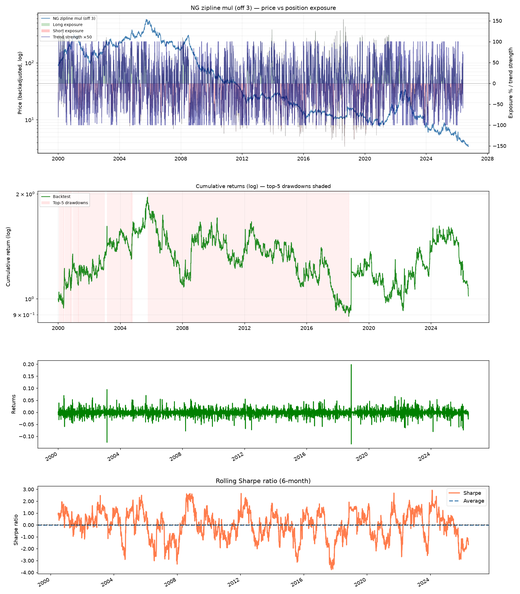](images/official/s03_ewmac_2_8/page1.png) | [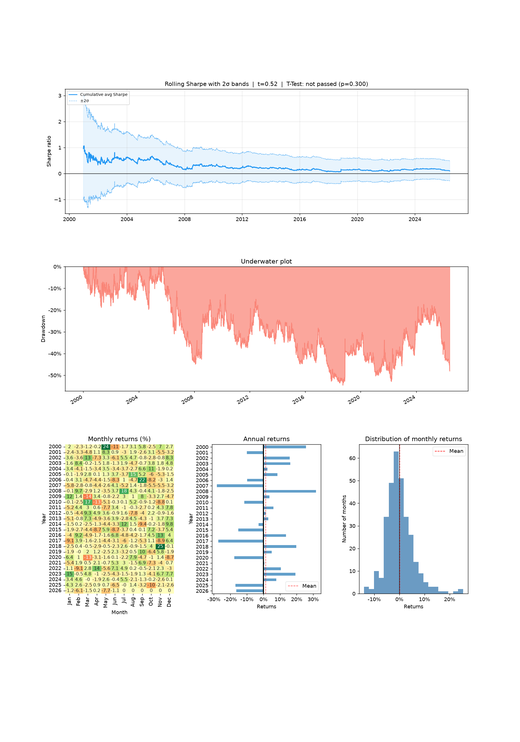](images/official/s03_ewmac_2_8/page2.png) |
| EWMAC 4/16 | [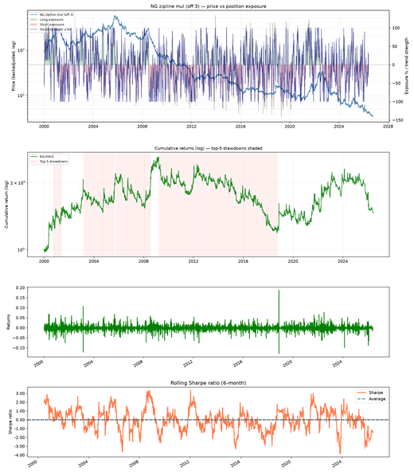](images/official/s04_ewmac_4_16/page1.png) | [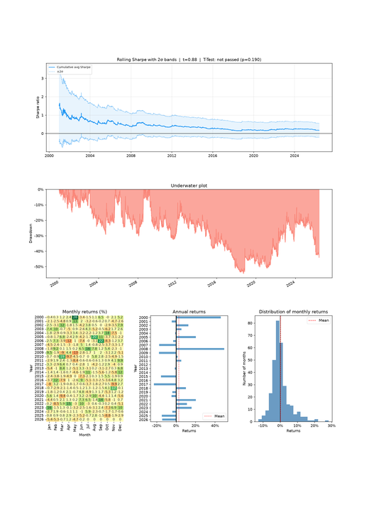](images/official/s04_ewmac_4_16/page2.png) |
| EWMAC 8/32 | [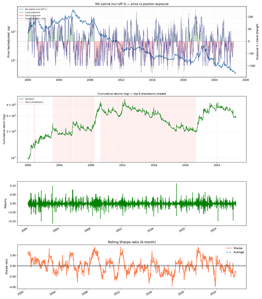](images/official/s05_ewmac_8_32/page1.png) | [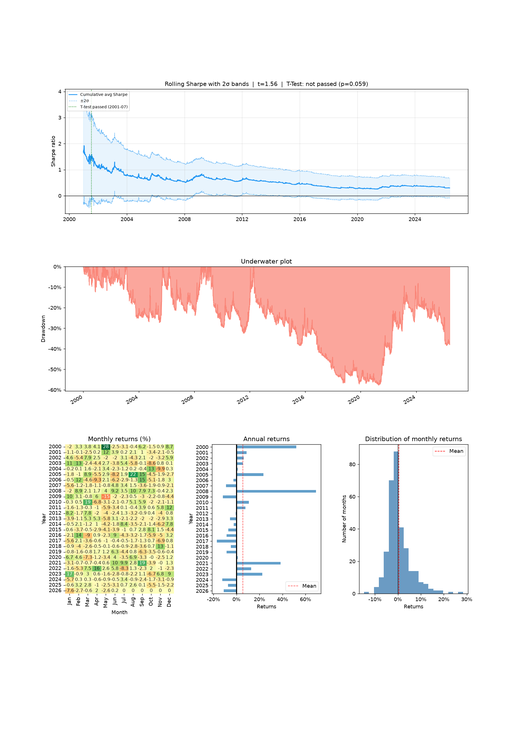](images/official/s05_ewmac_8_32/page2.png) |
| EWMAC 16/64 | [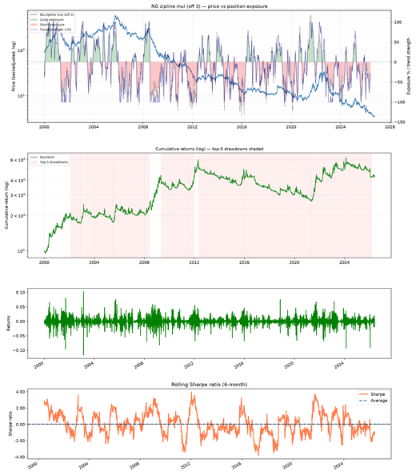](images/official/s02_ewmac_16_64/page1.png) | [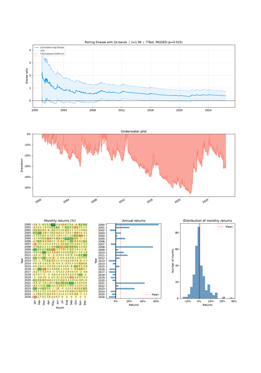](images/official/s02_ewmac_16_64/page2.png) |
| EWMAC 32/128 | [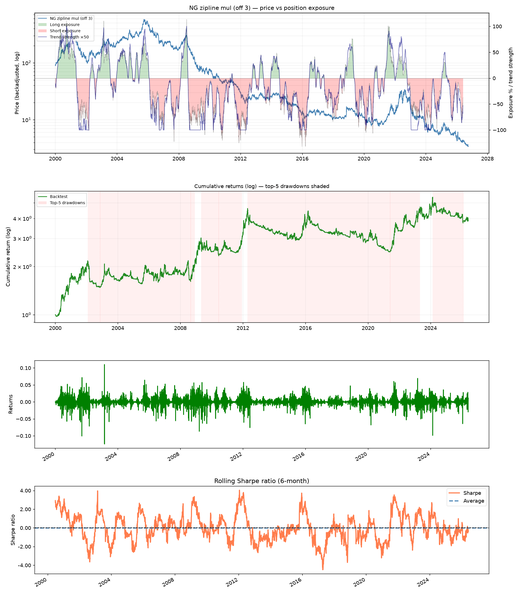](images/official/s06_ewmac_32_128/page1.png) | [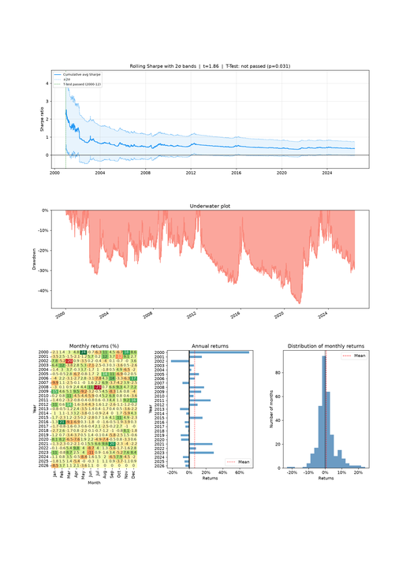](images/official/s06_ewmac_32_128/page2.png) |
| EWMAC 64/256 | [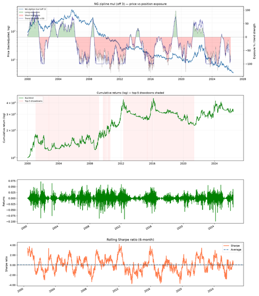](images/official/s07_ewmac_64_256/page1.png) | [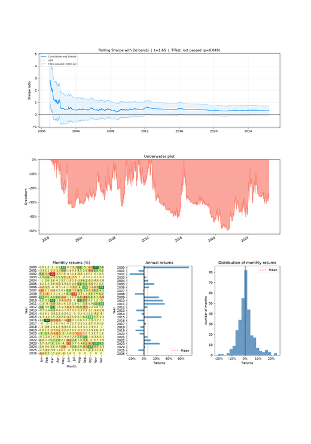](images/official/s07_ewmac_64_256/page2.png) |
| Carry (raw) — all year | [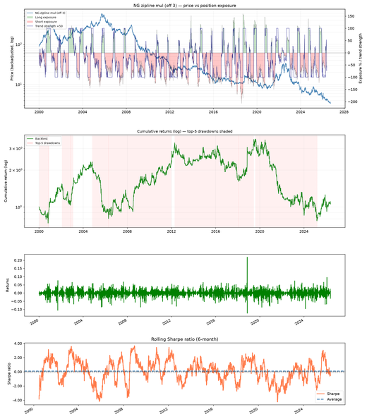](images/official/s08_carry_all_year/page1.png) | [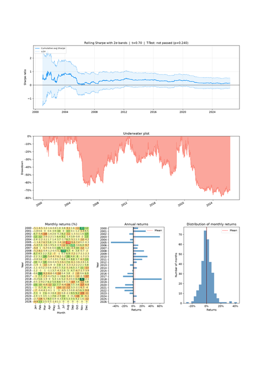](images/official/s08_carry_all_year/page2.png) |
| Carry (raw) — summer only | [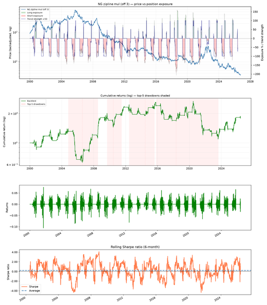](images/official/s09_carry_summer/page1.png) | [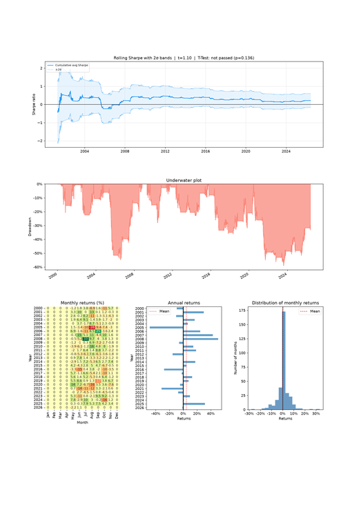](images/official/s09_carry_summer/page2.png) |
| Carry (seasonally adjusted) — all year | [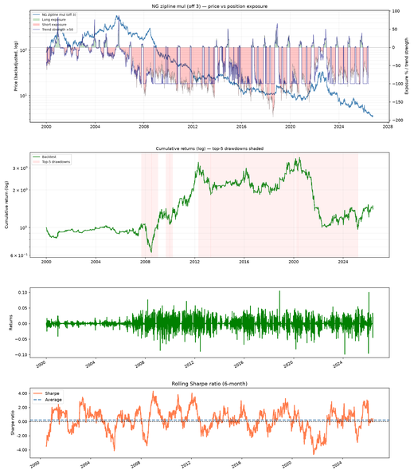](images/official/s10_carry_adj_all_year/page1.png) | [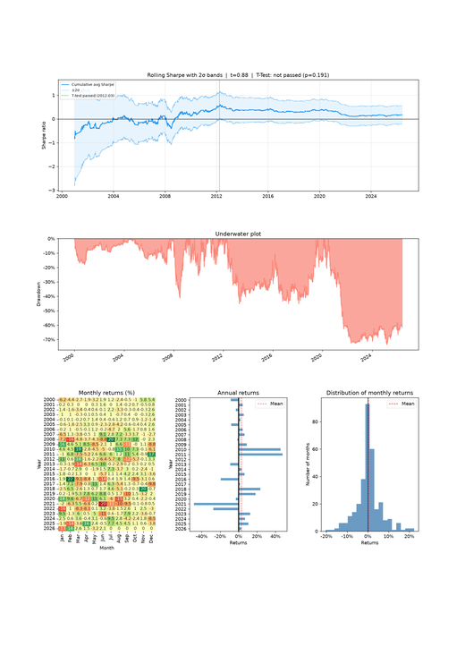](images/official/s10_carry_adj_all_year/page2.png) |
| Carry (seasonally adjusted) — summer | [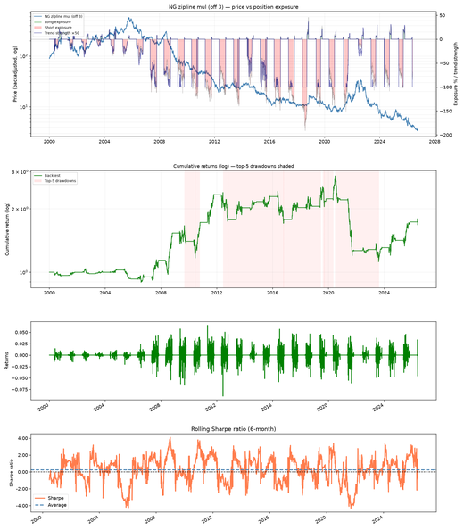](images/official/s11_carry_adj_summer/page1.png) | [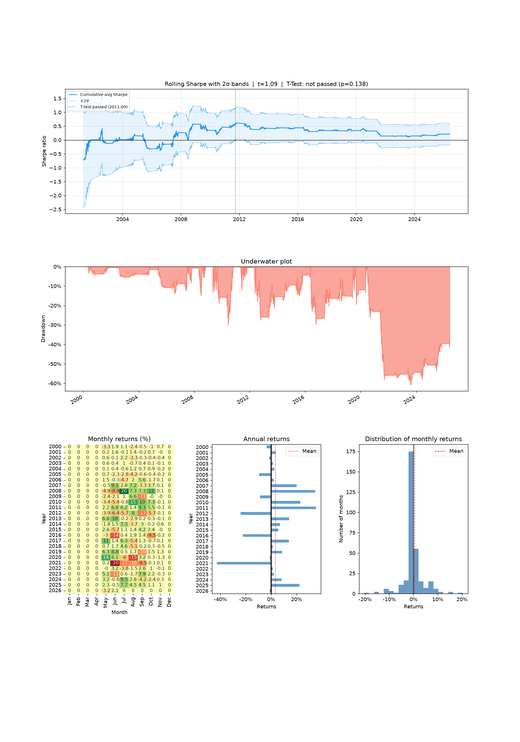](images/official/s11_carry_adj_summer/page2.png) |
| Weather — realised GWDD | [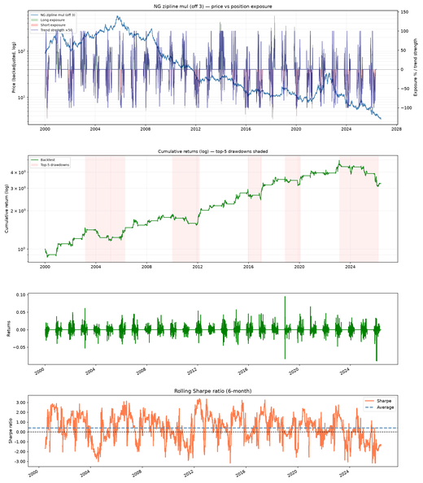](images/official/s12_weather/page1.png) | [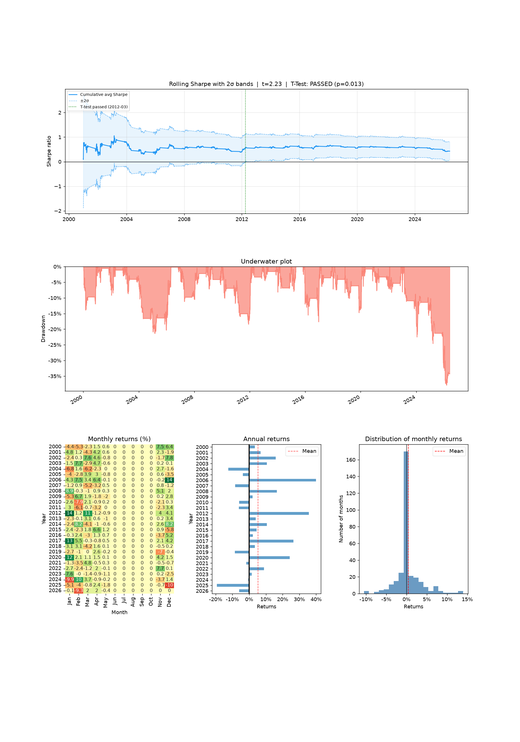](images/official/s12_weather/page2.png) |
| Inventory — after the EIA release | [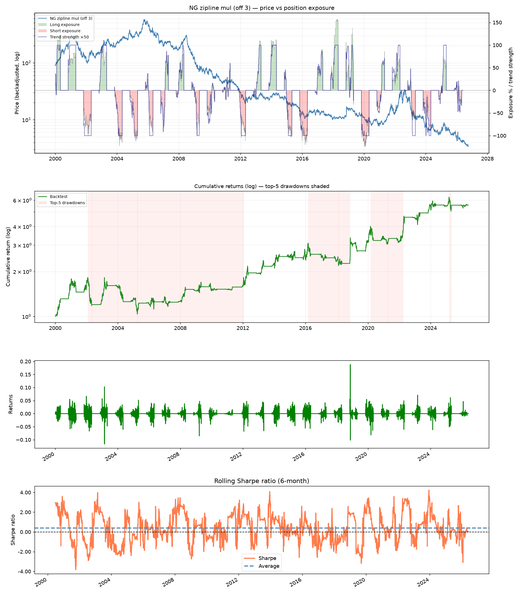](images/official/s13_inventory_eia/page1.png) | [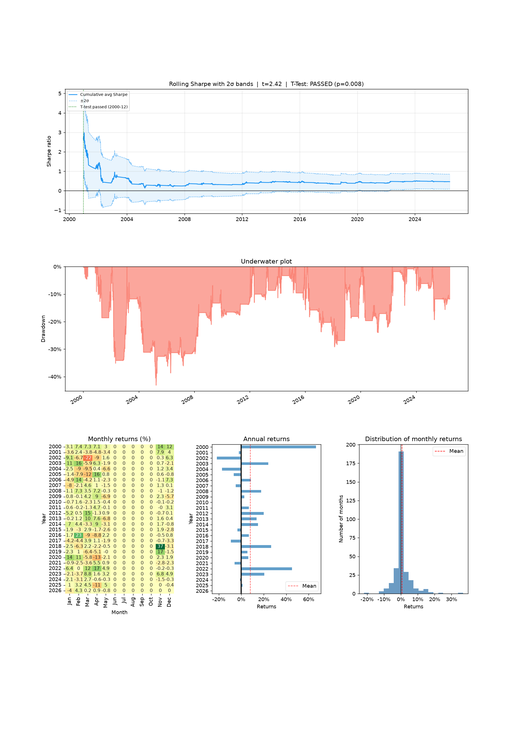](images/official/s13_inventory_eia/page2.png) |
| Inventory — before the release (nowcast) | [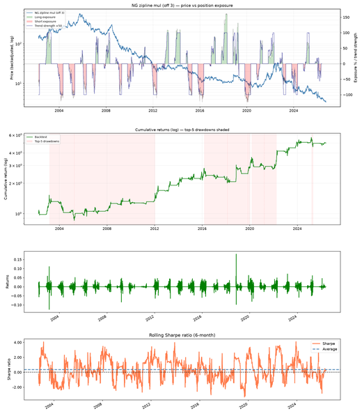](images/official/s14_inventory_nowcast/page1.png) | [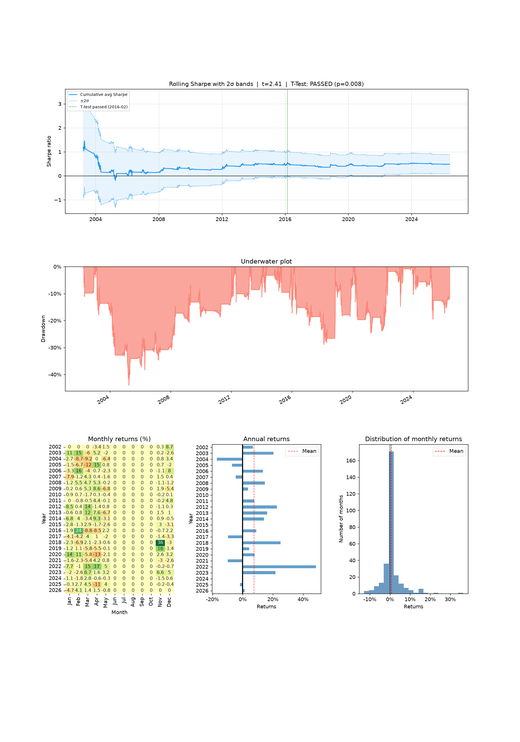](images/official/s14_inventory_nowcast/page2.png) |

</details>
<!-- GALLERY:END -->

------------------------------------------------------------------------

*This is a personal research project, not investment advice. Past performance, backtested or otherwise, is not indicative of future results.*
