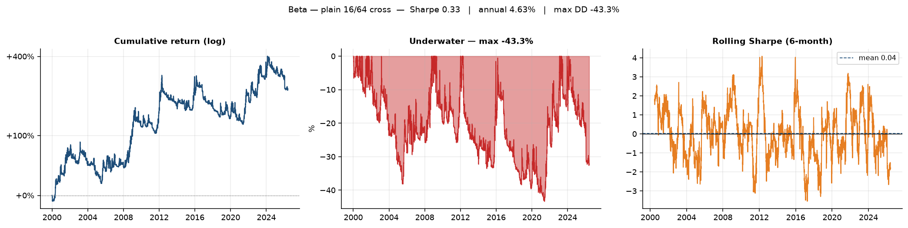
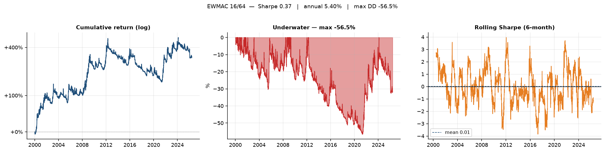
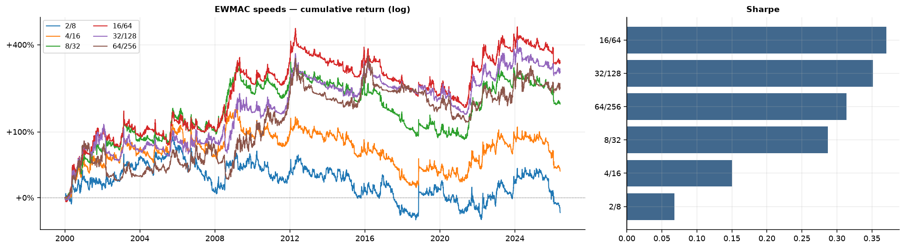
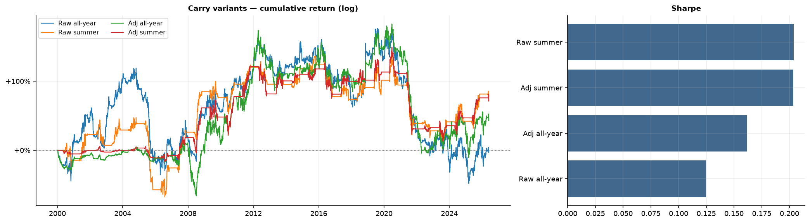
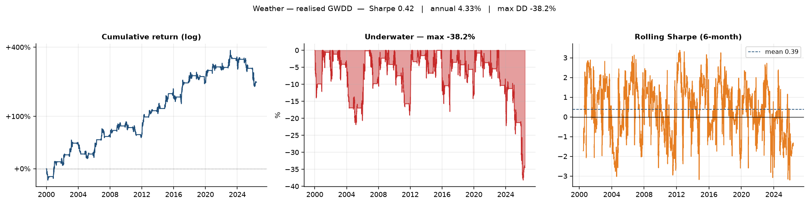
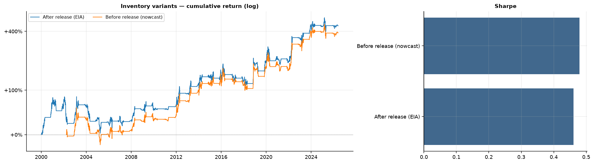
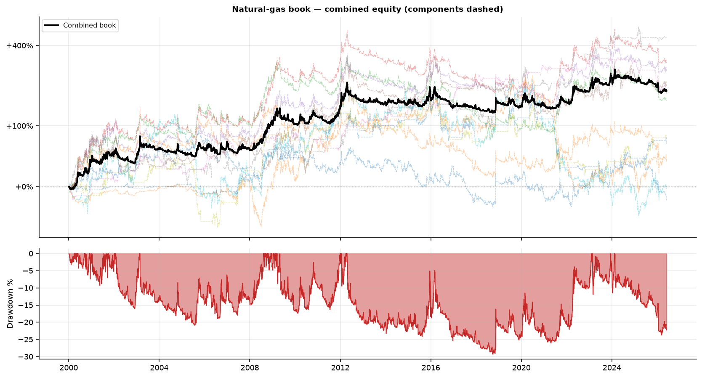
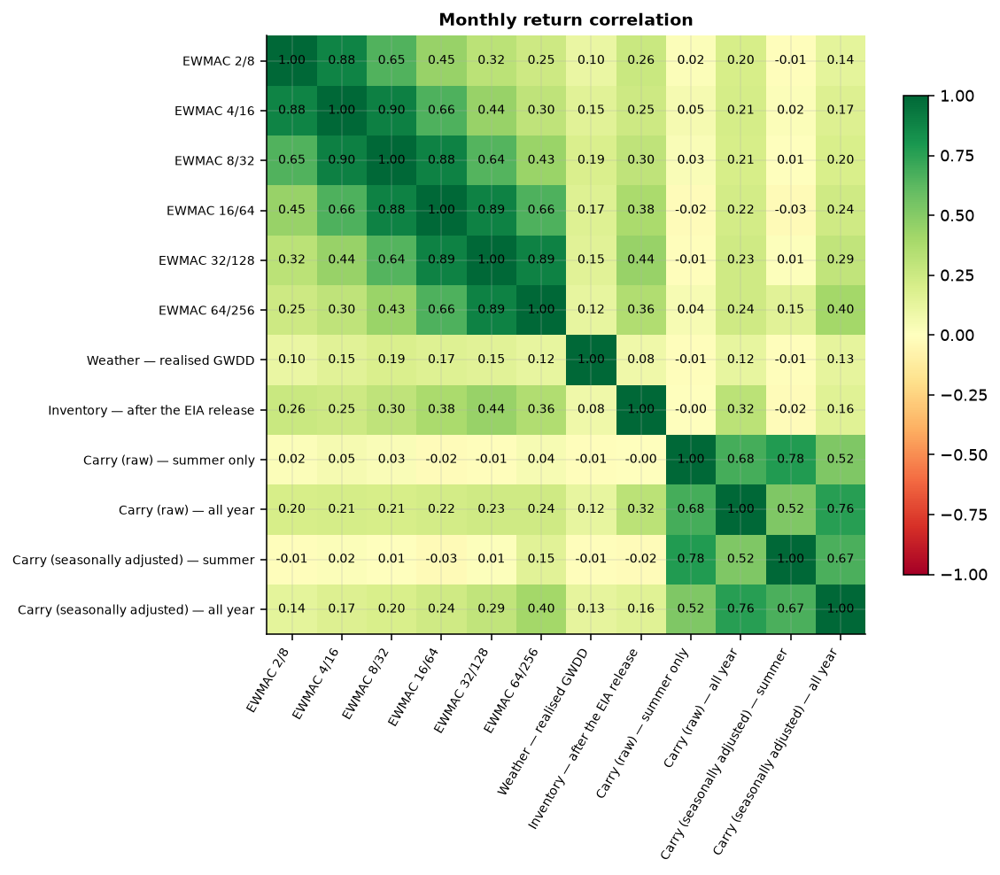
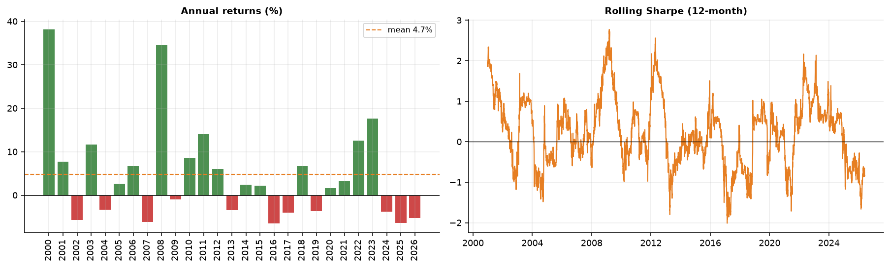

# Strategy metrics

_Auto-generated by `tools/build_readme_assets.py` from `results/Results.xlsx`. Do not edit by hand._

## 1. Beta — plain 16/64 cross

| Metric | Value |
|---|---|
| Annual return (net) | 4.63% |
| Annual volatility | 19.21% |
| Sharpe ratio | 0.33 |
| Sortino ratio | 0.38 |
| Max drawdown | -43.30% |
| Average drawdown | -20.77% |
| Skew (monthly) | 1.06 |
| Lower tail ratio (1/30 ÷ 4.43) | 2.977 |
| Upper tail ratio (99/70 ÷ 4.43) | 2.895 |
| Stability (R² of log-equity) | 0.79 |
| t-statistic | 1.727 |
| p-value (one-tailed) | 4.21% |
| Beta to 16/64 benchmark | 1.000 |
| Alpha vs benchmark (ann.) | 0.00% |

## 2. EWMAC 16/64

| Metric | Value |
|---|---|
| Annual return (net) | 5.40% |
| Annual volatility | 19.16% |
| Sharpe ratio | 0.37 |
| Sortino ratio | 0.44 |
| Max drawdown | -56.49% |
| Average drawdown | -23.97% |
| Skew (monthly) | 1.23 |
| Lower tail ratio (1/30 ÷ 4.43) | 2.811 |
| Upper tail ratio (99/70 ÷ 4.43) | 2.915 |
| Stability (R² of log-equity) | 0.65 |
| t-statistic | 1.926 |
| p-value (one-tailed) | 2.71% |
| Gross Sharpe (before costs) | 0.39 |
| Costs (Sharpe units) | 0.02 |
| Annual turnover | 16.4x / yr |
| Beta to 16/64 benchmark | 0.935 |
| Alpha vs benchmark (ann.) | 1.08% |

## 3–7. EWMAC — different speeds

| Metric | 2/8 | 4/16 | 8/32 | 16/64 | 32/128 | 64/256 |
|---|---|---|---|---|---|---|
| Annual return (net) | -0.58% | 1.04% | 3.72% | 5.40% | 5.03% | 4.38% |
| Annual volatility | 19.53% | 19.28% | 19.00% | 19.16% | 19.21% | 20.25% |
| Sharpe ratio | 0.07 | 0.15 | 0.29 | 0.37 | 0.35 | 0.31 |
| Sortino ratio | -0.05 | 0.09 | 0.31 | 0.44 | 0.41 | 0.34 |
| Max drawdown | -58.37% | -56.46% | -58.92% | -56.49% | -47.30% | -50.23% |
| Average drawdown | -31.65% | -26.94% | -26.48% | -23.97% | -21.51% | -25.20% |
| Skew (monthly) | 1.10 | 1.47 | 1.47 | 1.23 | 0.64 | 0.68 |
| Lower tail ratio (1/30 ÷ 4.43) | 2.553 | 2.752 | 2.815 | 2.811 | 2.821 | 2.300 |
| Upper tail ratio (99/70 ÷ 4.43) | 2.726 | 2.813 | 3.043 | 2.915 | 2.619 | 2.116 |
| Stability (R² of log-equity) | 0.27 | 0.00 | 0.31 | 0.65 | 0.78 | 0.72 |
| t-statistic | 0.353 | 0.781 | 1.494 | 1.926 | 1.828 | 1.630 |
| p-value (one-tailed) | 36.22% | 21.75% | 6.76% | 2.71% | 3.38% | 5.16% |
| Gross Sharpe (before costs) | 0.16 | 0.21 | 0.32 | 0.39 | 0.37 | 0.33 |
| Costs (Sharpe units) | 0.094 | 0.056 | 0.035 | 0.024 | 0.018 | 0.017 |
| Annual turnover | 109.0x / yr | 55.9x / yr | 29.5x / yr | 16.4x / yr | 10.1x / yr | 7.1x / yr |
| Beta to 16/64 benchmark | 0.405 | 0.602 | 0.803 | 0.935 | 0.876 | 0.701 |
| Alpha vs benchmark (ann.) | -1.57% | -1.20% | 0.18% | 1.08% | 1.19% | 1.82% |

## 8–11. Carry — trading the curve

| Metric | Raw all-year | Raw summer | Adj all-year | Adj summer |
|---|---|---|---|---|
| Annual return (net) | -0.04% | 2.07% | 1.18% | 1.92% |
| Annual volatility | 25.32% | 18.24% | 21.31% | 14.59% |
| Sharpe ratio | 0.12 | 0.20 | 0.16 | 0.20 |
| Sortino ratio | -0.00 | 0.17 | 0.09 | 0.19 |
| Max drawdown | -78.95% | -59.47% | -73.82% | -61.05% |
| Average drawdown | -34.82% | -23.71% | -27.08% | -18.05% |
| Skew (monthly) | 0.77 | 0.31 | 0.29 | -0.11 |
| Lower tail ratio (1/30 ÷ 4.43) | 2.163 | 2.047 | 3.857 | 4.058 |
| Upper tail ratio (99/70 ÷ 4.43) | 1.742 | 1.618 | 3.341 | 2.711 |
| Stability (R² of log-equity) | 0.01 | 0.23 | 0.26 | 0.35 |
| t-statistic | 0.649 | 1.059 | 0.841 | 1.058 |
| p-value (one-tailed) | 25.81% | 14.48% | 20.01% | 14.51% |
| Gross Sharpe (before costs) | 0.16 | 0.22 | 0.19 | 0.22 |
| Costs (Sharpe units) | 0.035 | 0.020 | 0.028 | 0.020 |
| Annual turnover | 14.7x / yr | 16.0x / yr | 12.2x / yr | 12.6x / yr |
| Beta to 16/64 benchmark | 0.419 | 0.048 | 0.371 | 0.022 |
| Alpha vs benchmark (ann.) | 1.08% | 3.54% | 1.10% | 2.77% |

## 12. Weather — realised GWDD

| Metric | Value |
|---|---|
| Annual return (net) | 4.33% |
| Annual volatility | 11.84% |
| Sharpe ratio | 0.42 |
| Sortino ratio | 0.57 |
| Max drawdown | -38.16% |
| Average drawdown | -7.57% |
| Skew (monthly) | 0.93 |
| Lower tail ratio (1/30 ÷ 4.43) | 2.281 |
| Upper tail ratio (99/70 ÷ 4.43) | 2.986 |
| Stability (R² of log-equity) | 0.95 |
| t-statistic | 2.168 |
| p-value (one-tailed) | 1.51% |
| Gross Sharpe (before costs) | 0.47 |
| Costs (Sharpe units) | 0.05 |
| Annual turnover | 74.2x / yr |
| Beta to 16/64 benchmark | 0.144 |
| Alpha vs benchmark (ann.) | 4.17% |

## 13–14. Inventory — trading the gas balance

| Metric | After release (EIA) | Before release (nowcast) |
|---|---|---|
| Annual return (net) | 6.48% | 6.63% |
| Annual volatility | 16.59% | 16.08% |
| Sharpe ratio | 0.46 | 0.48 |
| Sortino ratio | 0.60 | 0.64 |
| Max drawdown | -43.53% | -43.90% |
| Average drawdown | -16.07% | -15.61% |
| Skew (monthly) | 1.76 | 2.50 |
| Lower tail ratio (1/30 ÷ 4.43) | 2.550 | 2.583 |
| Upper tail ratio (99/70 ÷ 4.43) | 2.244 | 2.331 |
| Stability (R² of log-equity) | 0.86 | 0.92 |
| t-statistic | 2.398 | 2.385 |
| p-value (one-tailed) | 0.83% | 0.86% |
| Gross Sharpe (before costs) | 0.47 | 0.49 |
| Costs (Sharpe units) | 0.013 | 0.014 |
| Annual turnover | 13.8x / yr | 13.6x / yr |
| Beta to 16/64 benchmark | 0.391 | 0.413 |
| Alpha vs benchmark (ann.) | 5.20% | 6.10% |

## The combined book

| Metric | Value |
|---|---|
| Annual return (net) | 4.11% |
| Annual volatility | 12.89% |
| Sharpe ratio | 0.38 |
| Sortino ratio | 0.49 |
| Max drawdown | -29.23% |
| Average drawdown | -14.48% |
| Skew (monthly) | 1.32 |
| Lower tail ratio (1/30 ÷ 4.43) | 3.000 |
| Upper tail ratio (99/70 ÷ 4.43) | 2.777 |
| Stability (R² of log-equity) | 0.85 |
| t-statistic | 1.962 |
| p-value (one-tailed) | 2.49% |
| Beta to 16/64 benchmark | 0.567 |
| Alpha vs benchmark (ann.) | 1.20% |
